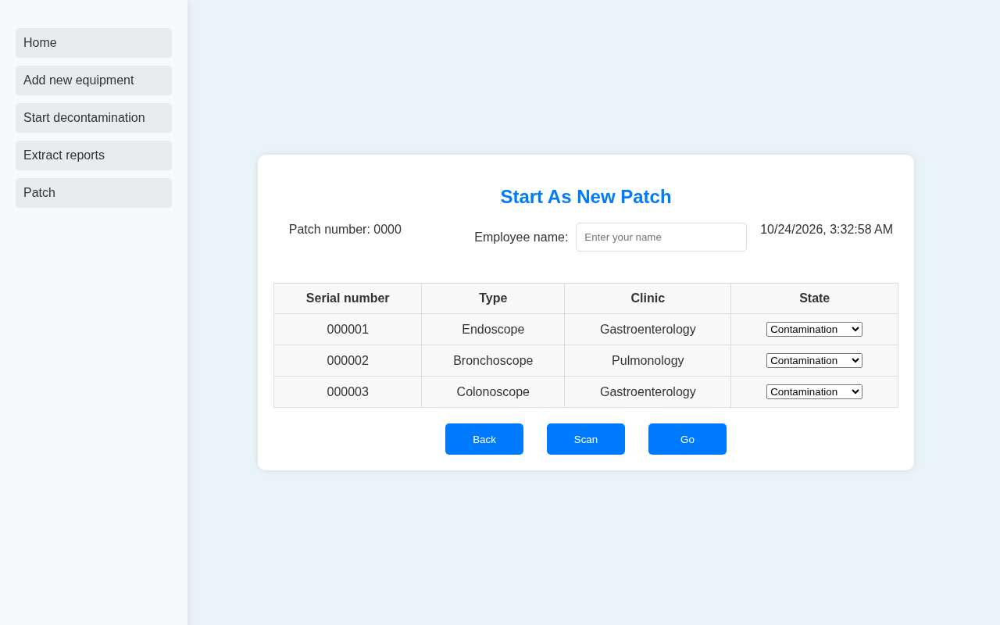
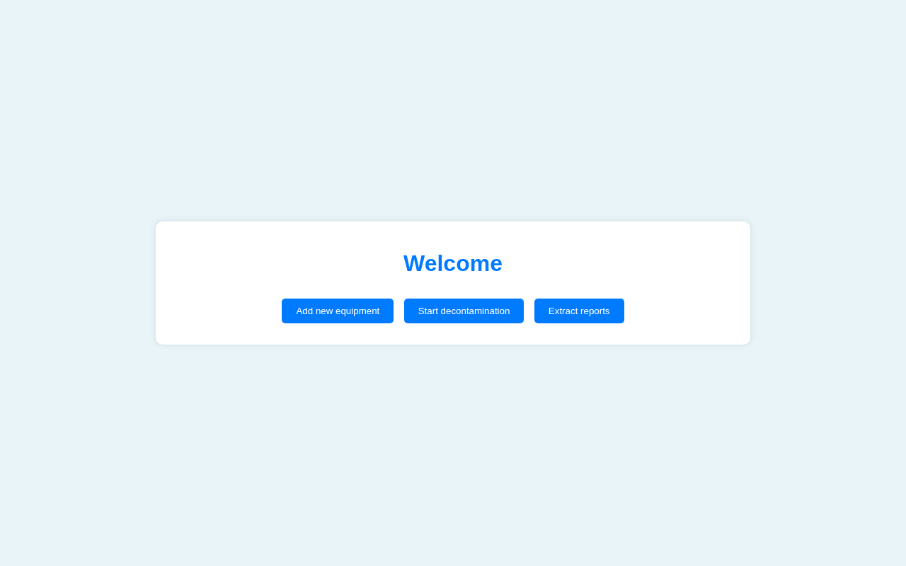
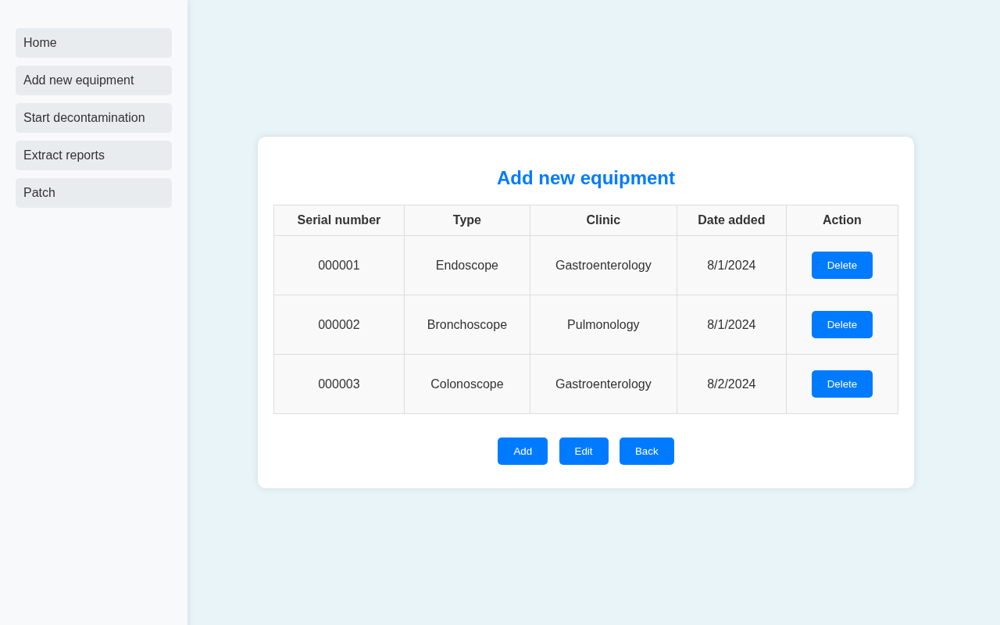
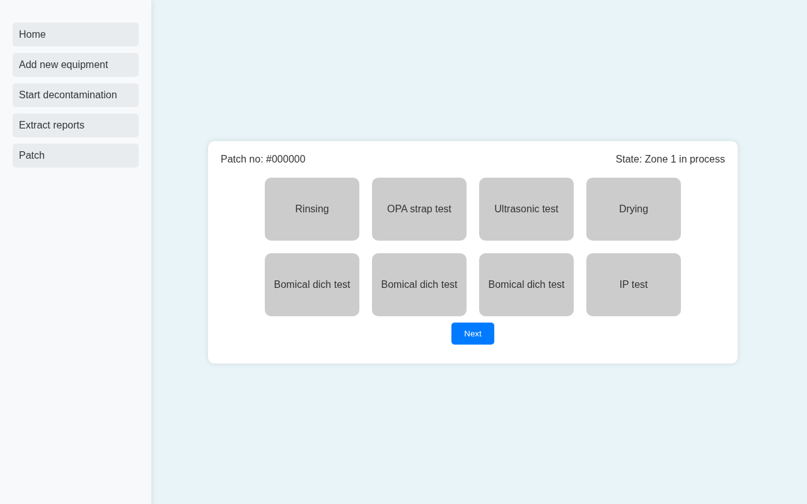

# Equipment Decontamination Tracker

> A lightweight web front-end for a hospital sterilization department. It registers medical equipment, groups items into decontamination batches ("patches"), and steps each batch through the cleaning and testing stages.



## Overview

This prototype was built during my summer training at **Medical Fakeeh** (June–August 2024) for the sterilization department. Staff need to know which equipment is contaminated, which batch it belongs to, and where each batch is in the decontamination workflow.

It is a static HTML/CSS/JavaScript app. Data is kept in the browser's `localStorage`, so it runs with no server.

## Features

- **Add new equipment:** register an item (type and clinic). The app assigns the next serial number, stores the date, and lets you delete entries.
- **Start decontamination:** start a new patch with the employee name and a live date/time, *scan* the registered equipment into the batch, and mark each item *Contamination* or *Decontamination*.
- **Process workflow:** an 8-stage pipeline (Rinsing → OPA strap test → Ultrasonic test → Drying → 3 × "Bomical dich test" → IP test, labels as in the UI). Each stage unlocks only after the previous one is completed, and **Next** enables when all stages are done.
- **Sidebar navigation** with a Patch sub-menu
- **Extract reports** placeholder (alert) for future reporting

## Screenshots

| Home | Add equipment |
|---|---|
|  |  |
| **Decontamination batch** | **Process stages** |
|  |  |

*(The screenshots use sample equipment data.)*

## Tech Stack

- HTML5, CSS3
- Vanilla JavaScript (DOM manipulation, `localStorage`)

## How to Run

No build step is needed. Open `index.html` in a browser, or serve the folder:

```bash
python3 -m http.server 8000
# then visit http://localhost:8000
```

To clear the stored data, run `localStorage.clear()` in the browser console.

## Project Structure

```
decontamination-tracker/
├── index.html             # welcome page
├── add-equipment.html     # register / list / delete equipment
├── decontamination.html   # start a new patch and scan equipment
├── process.html           # 8-stage decontamination workflow
├── scripts.js             # all page logic + localStorage
├── styles.css
└── docs/screenshots/
```

## Notes

This is a front-end prototype. The patch list in the sidebar is static, reports are not implemented yet, and data lives only in the current browser.

## Credits

Built by **Hala Jalal** during the Computer Science summer training (Umm Al-Qura University) at Medical Fakeeh, 2024.

## License

[MIT](LICENSE) © 2025 Hala Jalal
